# agency-from-gradients

<p align="center">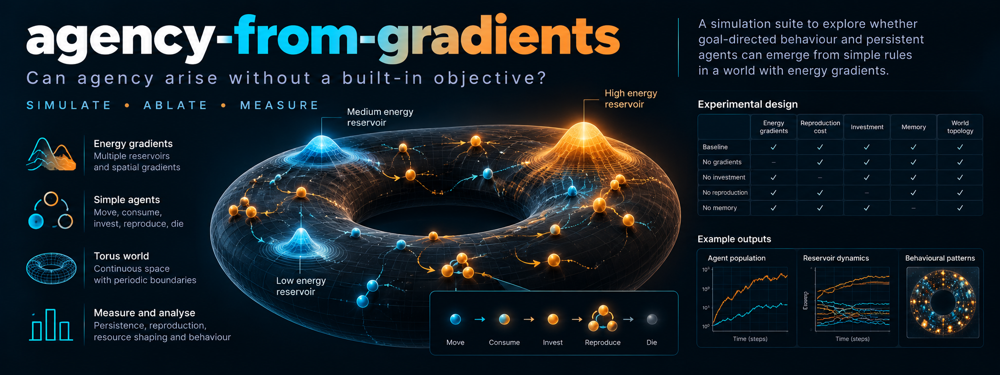</p>

<sub><i>The banner is an illustration. Its example charts are mock-ups, not results, and its design table is a sketch: the ablations actually implemented are food scarcity, heredity, mortality and succession (see below), and there is no memory ablation.</i></sub>

**agency-from-gradients** is a simulation suite built on one design hypothesis: if we want artificial agency, we should reproduce the conditions under which it arose on Earth, not hand agents an objective.

The argument starts from first principles. Structures that drain energy gradients persist, and each new structure feeds on what the last left unexhausted, from stars to supernovae to life. Life is the one case we know where this succession produced agents. The suite asks which of its conditions are load-bearing: a ladder of gradients, finite and contested resources, heredity with variation, a real cost of death, and succession.

Selection is by persistence and reproduction only. Entropy production is measured and never rewarded. Each condition is switched on and off in a factorial design, with hypotheses and falsifiers pre-registered.

> **This repo makes no novelty claim and proves nothing about Earth.** These are toy worlds. A positive result shows that a pattern is robust to ablation in an abstract setting. Whether the abstraction captures what mattered in reality is the central assumption, and we state it openly.

## Status: what exists and what doesn't

| Piece | State |
|---|---|
| World engine v1 (gradient ladder, asynchronous population, closed energy ledger) | Implemented, 46 tests |
| S0: re-analysis of earlier Study 2 genome trajectories | Implemented against an **assumed** JSON schema; never run on the real files |
| S1-S4 and positive control | **Confirmatory run done** (30 seeds per cell). See results below |
| S6: private benefit of opening deposits (free-rider test) | **Confirmatory run done**: not supported at this power |
| World v2: ~2,070-gene recurrent policy, memory, heritable body traits, seasons, walls, danger zones, signalling | Implemented and tested (ledger closes, v1 unchanged bit for bit) |
| S7: complex world over many generations | **Pilot only** (4 seeds, ~650 generations); a larger-world pilot is running; **not preregistered yet** |
| S8: total entropy as an explicit objective | **Pilot only** (2 optimisation runs per kappa); preregistered, confirmatory run pending |
| Plain-language explainer, live pond, GitHub Pages | Built; Pages workflow in place |
| S5: Barrow counter-test (efficiency pathway) | **Not implemented** |
| Predictive-information probe | **Not implemented** |

## Try it live

`webapp/index.html` is a single self-contained file. Open it in any browser, no install and no server. It runs the same world in JavaScript, in real time, and explains what you are seeing in plain language: a headline that narrates the current state, a "sunshine used or wasted" bar, where the creatures' energy comes from, and a panel of the creatures' average instincts. It is published to GitHub Pages by `.github/workflows/pages.yml` (one-time setup: Settings, Pages, Source = GitHub Actions). Pages cannot serve an arbitrary folder like `/webapp` directly, which is why a workflow is used.

Four presets: **Natural selection** (random creatures; those with spare energy have children), **Random parents** (a control), **Reward burning energy** (entropy used as the reward), and **A hand-coded expert** (fixed rules we wrote, to show what success could look like).

<p align="center">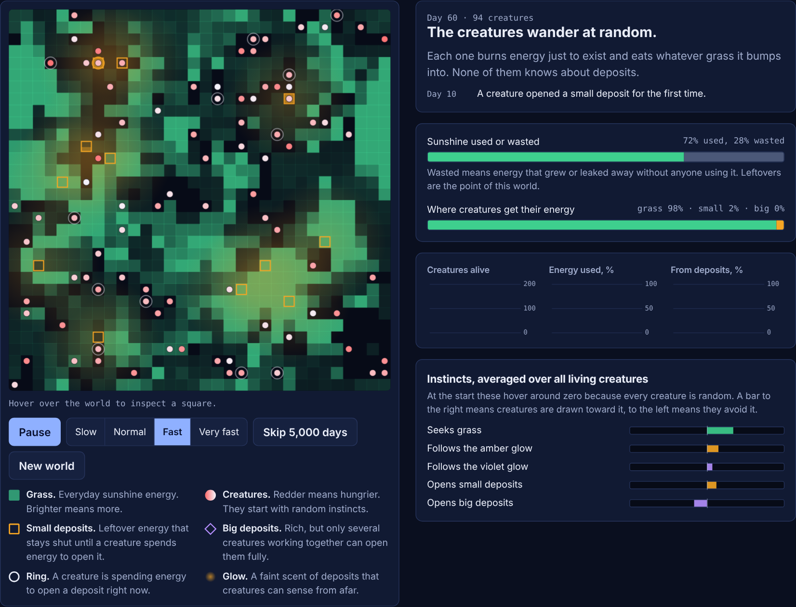</p>

**Day 60, natural-selection world.** Every creature starts with random instincts. 98% of their energy is grass, and the instinct bars hover near zero. Large amounts of energy are still wasted.

<p align="center">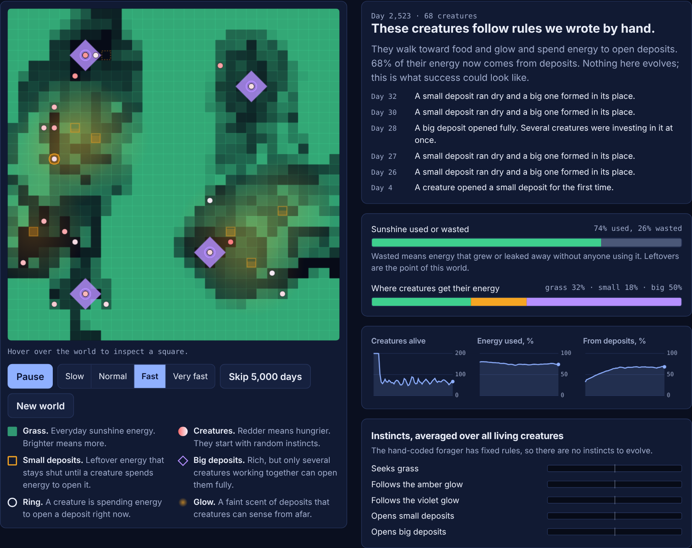</p>

**Hand-coded expert, day ~2,500.** Rules we wrote by hand walk toward food and glow and pay energy to open deposits. Here 50% of their energy comes from big deposits, and several creatures stand on each big deposit keeping it open. This is the positive control: it shows the world has headroom. Nothing evolves here.

<p align="center">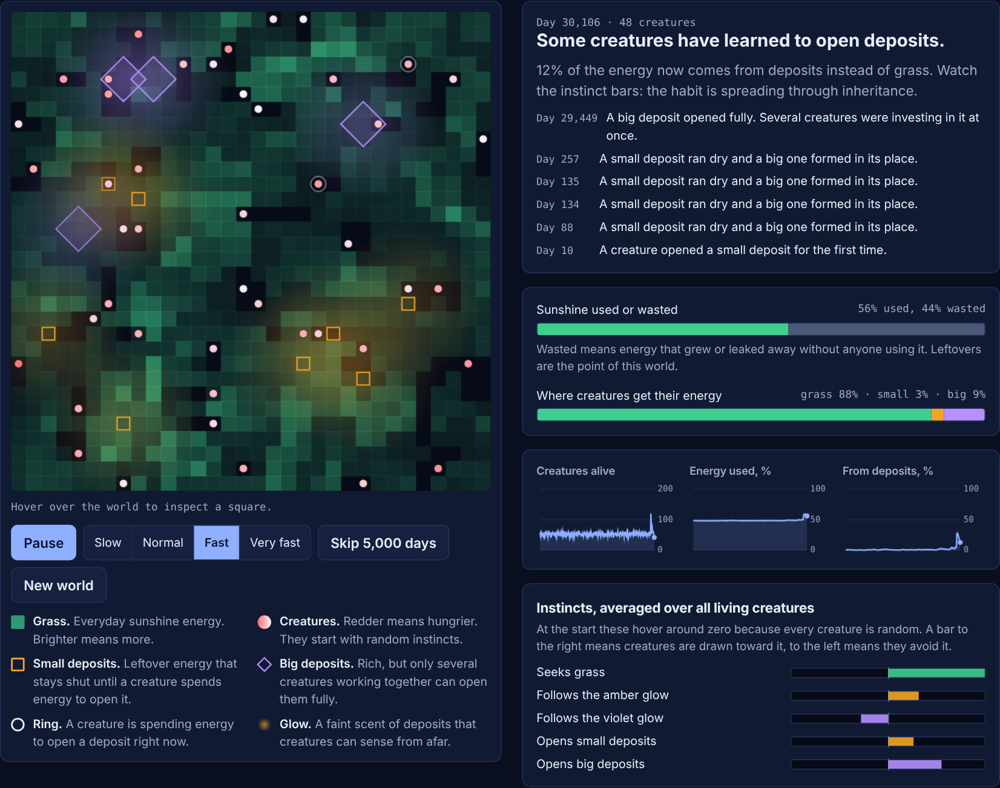</p>

**Natural-selection, day ~30,000.** In this run, inheritance has shifted the instincts: the "opens big deposits" bar moved right and 9% of energy now comes from big deposits. This is one stochastic example. In other runs, evolved creatures never use the deposits (we saw this in an earlier capture of the same preset), which is exactly why the confirmatory experiments use 30 seeds per condition rather than a picture.

<p align="center">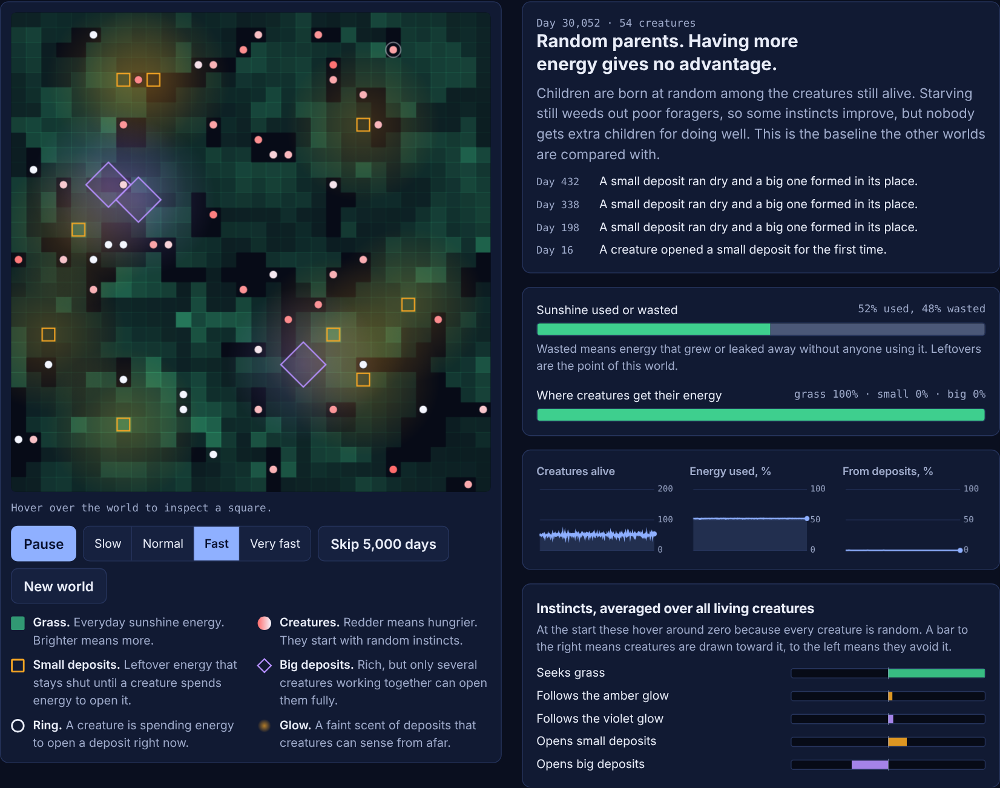</p>

**Random-parents control, day ~30,000.** Children are born to randomly chosen living creatures, so having more energy gives no advantage in having children. All energy is grass. Caveat: this is not a fully neutral control. Starving still removes some genomes, so viability selection remains and only fecundity selection is removed. See the note in the [pre-registration](PREREGISTRATION.md#deviation-log).

<p align="center">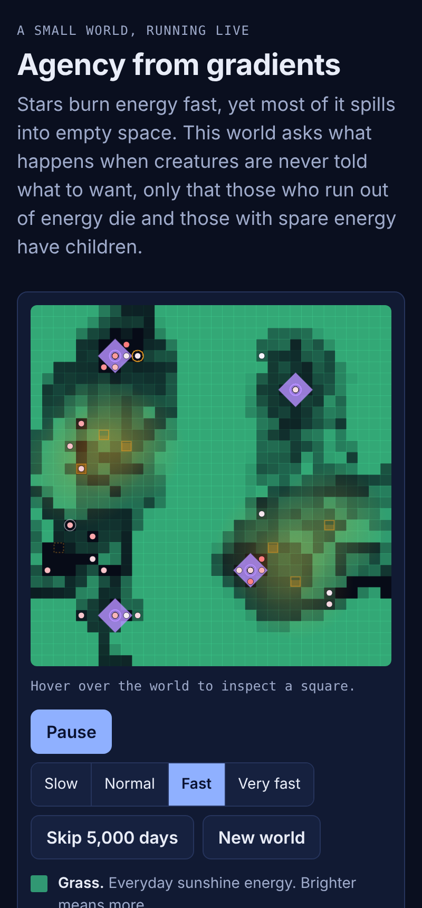</p>

Reading the screenshots: they are single seeded runs chosen to illustrate the interface. They are not evidence for the thesis. The evidence, such as it is, is the preregistered experiments.

### Plain-language explainer

[`explainer/index.html`](explainer/index.html) is a scroll-through page for non-specialists. A waterfall illustration of "energy always spills", a live pond (the same model drawn as swimming creatures, glowing energy motes and wells, not a grid), the real 30-seed results in plain words, and a switchboard that replays the actual ablation data. It also lists what the work does not show. Published by the Pages workflow at the site root, with the technical grid view at `/lab/`.

<p align="center">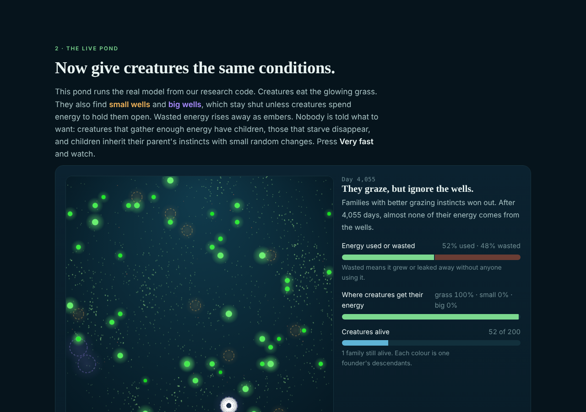</p>

## Hypotheses and falsifiers

Written down before any confirmatory run: [`PREREGISTRATION.md`](PREREGISTRATION.md).

## Quick start

```bash
pip install -e ".[dev]"
pytest -q                                   # ~10 s

# plumbing check (tiny runs)
python -m agency_gradients.experiments.s2_ablation --smoke

# pilot on held-out seeds (>=1000); do NOT use these for confirmatory claims
python -m agency_gradients.experiments.s_control   --seeds 4 --seed0 1000
python -m agency_gradients.experiments.s1_selection --seeds 4 --seed0 1000

# confirmatory (seeds 0..29, 20000 steps) - roughly 30-60 min per experiment on 2 cores
python -m agency_gradients.experiments.s1_selection
python -m agency_gradients.experiments.s2_ablation
python -m agency_gradients.experiments.s3_succession
python -m agency_gradients.experiments.s4_agency

# later experiments
python -m agency_gradients.experiments.s6_private_benefit
python -m agency_gradients.experiments.s7_complex_world --seeds 4 --seed0 1000      # pilot; 100,000 steps per run
python -m agency_gradients.experiments.s8_entropy_objective --seeds 2 --seed0 1000  # pilot

# S0 needs your saved files
python -m agency_gradients.experiments.s0_reanalysis 'data/evo_*.json' --tier2-threshold 0.6
```

Each experiment writes a CSV of every run and a Markdown report to `results/` (git-ignored).

## Confirmatory results (seeds 0-29, 20,000 steps, as preregistered)

Raw per-run CSVs and the generated reports are in [`docs/results/`](docs/results/). The commit and environment are in `RUN_INFO.txt`. Intervals are 95% bootstrap CIs. **The headline: the thesis as preregistered is only partly supported in this world, and its central ablation prediction (H2) failed.**

| | Prediction | Result | Verdict |
|---|---|---|---|
| **H1** | Persistence selection raises entropy production over random parents | +2.34 [1.08, 3.66] (27.3 vs 24.9) | **Supported**, small effect |
| **H2** | Scarcity, heredity and mortality are each needed for big-deposit access | All-on minus factor-off: scarcity -0.27 [-0.50, -0.03], heredity -0.73 [-0.90, -0.57], mortality -0.53 [-0.73, -0.33], succession -0.10 [-0.33, 0.13] | **Falsified** for all three: removing any of them *raised* big-deposit access. Succession: not shown |
| **H3** | Heredity contributes to recovery from displacement | Full minus no-heredity: +0.220 [0.189, 0.249] | **Supported**, with a caveat below |
| **H4** | Rewarding entropy directly does not beat persistence on big-deposit access | -0.10 [-0.30, 0.10] | **Not falsified** (absence of a difference is not evidence of none) |
| **H5** | Accounting check: capture ratio with kappa = 1 in 0.7-1.15 | 1.080 [1.017, 1.143] | **Passes**, barely inside at the upper CI |

<p align="center">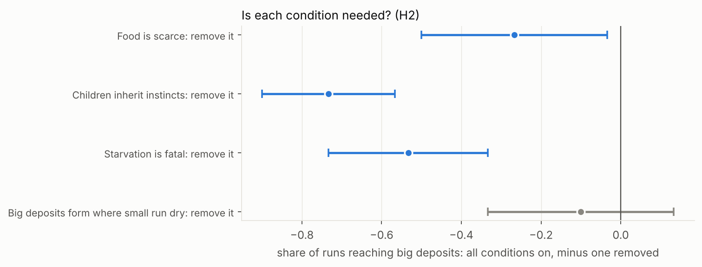</p>

### What the results do and do not say

- **The world is not degenerate, and there is headroom.** The hand-coded forager reaches big deposits in 100% of runs and gets 50% of its energy from them, with an entropy rate of 37.1. Evolved populations reach big deposits in 27% of runs, get 2% of their energy from them, and reach 27.3. Selection moved things a little way (H1), and left most of the available gain unused.
- **H1 is weaker than it looks.** The random-parents control still has viability selection (see limitation 6), so H1 measures fecundity selection on top of it. Rewarding grass-eating (26.5) also appears to beat random parents (no interval computed for that contrast), so the gain is not specific to persistence. Persistence versus task reward was not a preregistered contrast.
- **H2 failed, and the likely reason is a free-rider problem. This explanation is post hoc and untested.** Opening a deposit costs the investor energy, and the payoff is shared with everyone on the square. When starvation is fatal and genomes are inherited, evolution appears to select against paying that cost: in the one evolved world we inspected, the instincts avoided deposits. The data are consistent with this: with scarcity and mortality on, fresh random genomes reach big deposits in 100% of runs versus 27-37% for inherited ones. Removing mortality (bailouts) lifts the tier-2 energy share from about 4% to 30-35% under scarcity. But `t2_reached` only means a site was ever fully open, not that it was used steadily, and the tier-2 energy share is low in every mortal cell (1.4-5.9%). Treat the mechanism as a hypothesis for the next experiment, not a finding.
- **Entropy rate is not comparable across S2 cells.** Abundant-food and no-mortality cells fill the population cap (200) and so have entropy rates of 90-130 against 27-33 in the scarce, mortal cells. That is population size, not agency.
- **H3 is narrower than "agency".** The recovery gain needs heredity (full minus no-heredity = 0.22). But random-parents selection gives almost the same gain (0.259 vs 0.270 for persistence): what is inherited is mostly better grass-foraging filtered by starvation. It does not require selection by surplus. The raw evolved-minus-random gap is also inflated by survivorship, which is why the contrast is the preregistered quantity.
- **Succession did not help.** The ladder without succession had a higher entropy rate (33.0) than the full ladder (27.3) and a nominally higher big-deposit rate (0.37 vs 0.27), though the preregistered succession effect on `t2_reached` is not shown (CI includes zero).
- **Not tested:** whether any of this transfers to Earth, whether a less-biased policy class would behave differently (the generic MLP did not evolve), Barrow's miniaturisation counter-argument (S5), or prediction.

### S6: testing the free-rider explanation (preregistered in [`PREREGISTRATION_S6.md`](PREREGISTRATION_S6.md))

If opening a deposit were a public good that selection punishes, making the benefit private should help. In the `contributor` rule the harvest on a deposit is split by each agent's recent investment. Result (30 seeds): **not supported at this power**.

- H6a, contributor minus equal sharing (heredity on): tier-2 energy share +0.024 [-0.023, 0.075]; reached big deposits +0.13 [-0.10, 0.37]. The direction is as predicted, the interval includes zero.
- H6b, heredity minus no heredity (contributor): tier-2 share -0.017 [-0.059, 0.032]; reached big deposits -0.60 [-0.77, -0.43]. Heredity still does not help, and random fresh genomes still reach big deposits in 100% of runs.

So the simple free-rider story is not confirmed. Something else makes inherited policies avoid, or fail to sustain, the big deposits. Candidates (untested): the policy class is too constrained to learn a conditional, cooperative "invest only when others are nearby" rule; the cost and the payoff arrive too far apart for 27 genes to link; or the extrinsic hazard dominates. This is why the next step is a richer world and genome (below).

<p align="center">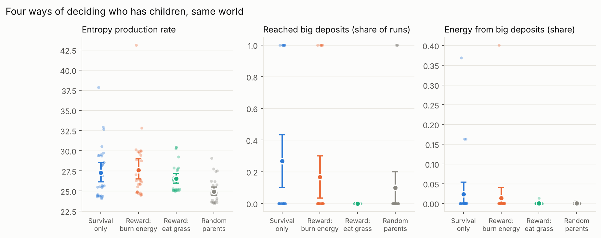</p>
<p align="center">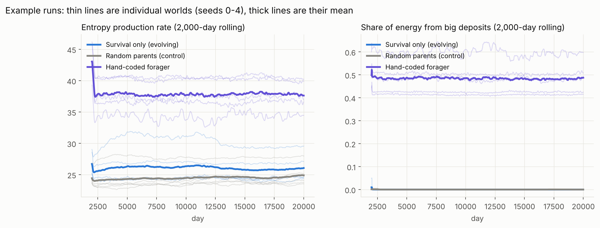</p>
<p align="center">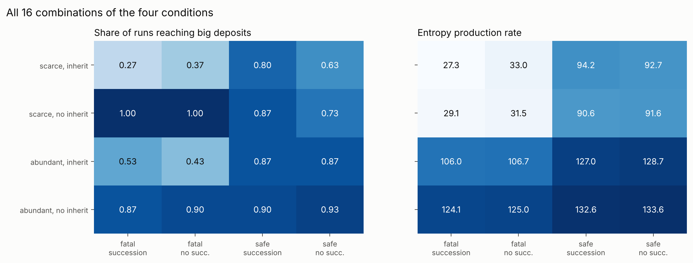</p>
<p align="center">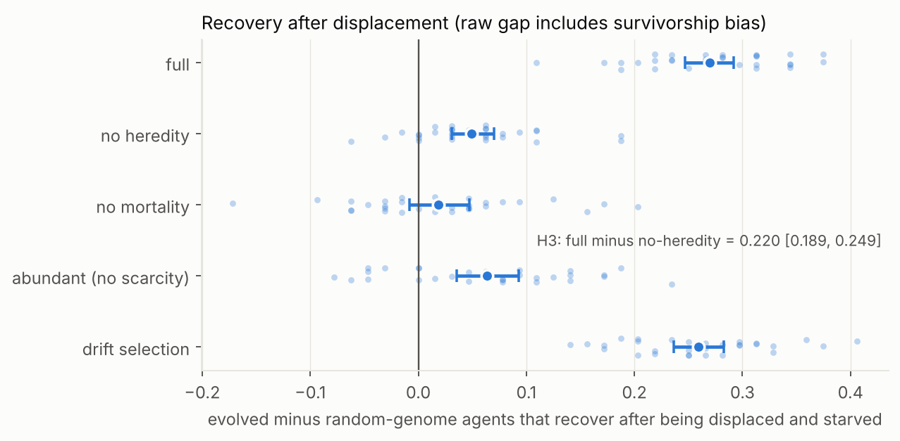</p>
<p align="center">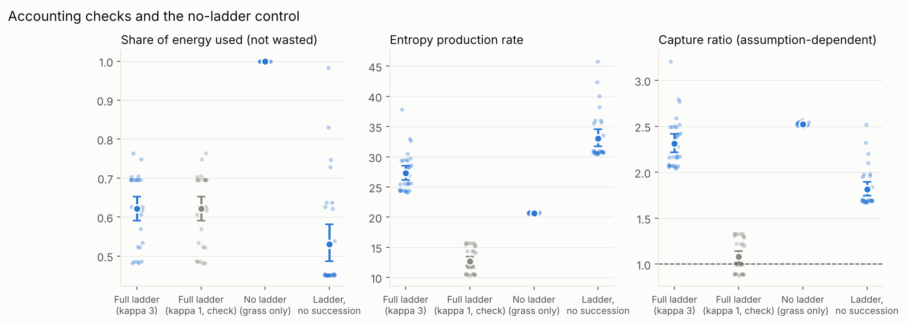</p>
<p align="center">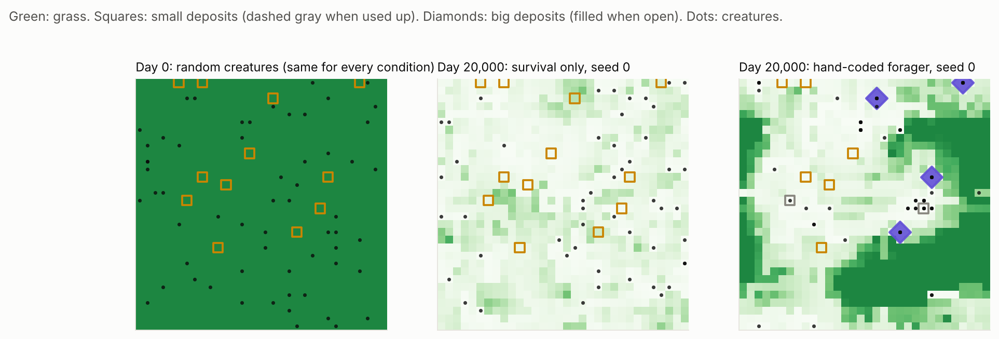</p>

## World v2: a much bigger genome and many generations

Prompted by the objection that agency will not evolve from a few dozen genes. `Config(world_v2=True)` (use `v2_config()`; the default world is unchanged) adds:

- **A recurrent policy with memory** (`recurrent`, about 2,070 genes; `mlp2` feed-forward, about 1,400; `equivariant2`, the 29-gene control on the same world). Genomes include two heritable body traits: size (bigger bodies eat more and burn more) and reproduction threshold.
- **Seasons** (commons regrowth rises and falls), **impassable walls**, **danger zones** with extra death risk, and a **pheromone channel**: a seventh action that leaves a decaying, diffusing signal other creatures can sense. Signalling costs energy.
- **Two-scale random mutation**: frequent small point mutations plus rare large ones. `v2_config(scale=2)` quadruples the torus at constant density, so populations of about 200 give a 2,000-gene genome more mutational supply.
- The energy ledger still closes (tested through every option). The pheromone is information, not energy.

The hand-coded forager still runs in v2 (the first 37 observation channels are identical).

### S7 pilot: has not shown anything yet

4 seeds, 100,000 steps (about 650 generations on average), 5 variants (`docs/results/pilot/s7_*`):

- The 2,070-gene recurrent policy did **not** find big deposits (tier-2 energy share about 0.1%), beat random parents on entropy rate (+4.9) but random parents went extinct in 1 of 4 runs, so that gap is confounded, and did *worse* than the 29-gene chemotaxis policy on the same world (-4.0).
- Its learning curve was flat after about 40% of the run. This is a pilot with 4 seeds and is not evidence about the thesis. A larger-world pilot (about 200 agents, 200,000 steps) is running on GitHub Actions; S7 will be preregistered after it, and before any confirmatory run.

## S8: what if entropy IS the objective? ([`PREREGISTRATION_S8.md`](PREREGISTRATION_S8.md))

The reverse of everything above, on purpose. A single shared controller is optimised directly for the world's total entropy production with evolution strategies. Life forms eat and scavenge leftover energy exactly as before, but nothing rewards survival or reproduction. We then ask what behaviour the objective produces.

Pilot (2 optimisation runs per kappa, seeds 1000-1001; **not confirmatory**, `docs/results/pilot/s8_*`):

| kappa = 3 | entropy rate | capture fraction | big-deposit share | actions spent investing |
|---|---|---|---|---|
| optimised for entropy | 40.0 | 0.92 | 0.41 | 0.71 |
| hand-coded forager | 29.0 | 0.49 | 0.63 | 0.27 |
| random controller | 19.0 | 0.42 | 0.06 | 0.13 |
| always move | 20.3 | 0.55 | 0.00 | 0.00 |
| no life forms | 11.8 | 0.00 | 0.00 | 0.00 |

- With entropy as the objective, the controller captures nearly everything (92%) and parks at the big deposits, spending 71% of its actions on investing. Investing is the costliest action, so it is also the most entropy-producing: this looks like a **furnace**, not a forager. It beats our best hand-written forager on the objective itself, which is exactly what an objective-maximiser should do.
- At kappa = 1 the controller gained little (14.4 vs 11.0 for random, 15.3 for the forager) and the two runs disagreed (11.8 and 16.2). At kappa = 1 entropy is almost fixed by the energy inflow, so there is little to optimise.

**Two cautions that apply to every S8 result.** (1) The objective counts agent dissipation as kappa times passive leakage, so "capture energy and burn it" scores higher by construction: S8 shows *which behaviour* maximises an assumed quantity, not that the assumption is right. (2) One shared controller removes the free-rider problem that blocked individual selection in S2 and S6. Cooperation is trivial when all agents run the same rule, so S8 cannot be read as "objective-driven evolution solves cooperation".

The objective can be gamed, which is the point of testing it: an explicit entropy goal selects for burning energy, not for anything we would call agency.

## Reproducing on GitHub Actions (no tokens, no local compute)

All long runs can be started from the repo's Actions tab: `confirmatory-runs` (S1-S4 and the control), `complex-world-runs` (S6 and the five S7 variants), `s7-custom` (free-form S7 pilots, scaled worlds), `s8-entropy-objective` (S8), and `pages` (publishes the explainer and the grid view). Each uploads its results as artifacts and also commits them to a `ci-results` branch, so they can be read without downloading artifacts.

## Notes from the pilot (seeds 1000-1003, not confirmatory)

- The world went through ten design changes because early pilots showed null results. They are listed in [`docs/DESIGN.md`](docs/DESIGN.md#design-history-forced-by-pilots). A design tuned until selection beats random parents tends to make selection beat random parents, so weigh H1 with that in mind. H2 failing despite this tuning is some evidence the tuning did not simply guarantee the thesis.
- The pilot suggested entropy-as-reward would not breed more entropy than persistence. The confirmatory run agrees (H4 not falsified).

## Known limitations

1. **Toy world, one abstraction.** Whether these five features are what mattered on Earth is assumed, not tested.
2. **The default policy has a strong prior.** The `equivariant` policy (about 27 parameters, shared weights across directions) is chemotaxis-shaped. A generic MLP policy did not evolve useful behaviour in the available budget. So "agency emerged" here means "a small, well-shaped policy was tuned by selection", which is a much weaker claim than emergence from nothing.
3. **Capture Ratio is largely an accounting identity.** It depends on an assumed `kappa` (entropy per unit energy for agents vs passive leakage). S3 includes a `kappa = 1` row as a sanity check. The empirical quantities are the capture fraction and tier shares.
4. **Viability restoration is not prediction.** And the raw evolved-vs-random gap is inflated by survivorship; only the full-vs-no-heredity contrast is interpretable (see the S4 docstring).
5. **The gradient ladder is held fixed** in the factorial design, because removing it would make tier ascent false by construction. Its necessity is only probed by the S3 no-ladder control, which is not a test of agency.
6. **The drift control is not fully neutral.** Parents are random among survivors, so starvation still filters genomes. Only fecundity selection is removed. H1 therefore measures the effect of fecundity selection on top of viability selection.
7. **S8's objective is an assumption wearing a measurement's clothes.** Entropy counts agent dissipation at kappa times passive leakage, so energy capture is rewarded by construction, and a shared controller sidesteps cooperation problems that individual selection faces.
8. **World v2 is untested at scale.** The large-genome pilot has not shown the behaviour the thesis predicts, and we do not yet know whether that is the world, the mutation model, population size, or the number of generations.
9. **The extrinsic death hazard** (needed for enough generations) is itself a built-in selection pressure.

## Roadmap

- S7: finish the larger-world pilot, then preregister and run the confirmatory comparison of the recurrent policy against random parents and the small policy.
- S8: confirmatory run (5 optimisation runs per kappa), then a behaviour analysis of what the optimised controllers actually do.
- If big deposits are still not found under individual selection: kin sharing (benefits shared among relatives), larger populations, and sexual recombination.
- Bring the v2 world into the explainer's pond.
- S5: add an efficiency pathway and deplete gradients, to see whether populations go thermodynamically quiet (Barrow's miniaturisation counter-argument).
- Predictive-information probe, which needs the MLP policy to evolve (or a memory-bearing equivariant variant).
- Run S0 on the real Study 2 trajectories.

## Layout

```
src/agency_gradients/
  config.py        every knob; a run is fully described by (Config, seed)
  world.py         the engine and its energy ledger
  controls.py      hand-coded positive control
  world_v2.py      the richer world (recurrent policy, signalling, seasons, walls, danger)
  policies_v2.py   v2 policies and heritable traits
  probes.py        viability-restoration probe
  stats.py         bootstrap helpers (numpy only)
  runner.py        parallel job runner and CSV output
  experiments/     s0 ... s4, s6, s7, s8, plus the positive control
webapp/            browser version of the world, technical grid view (index.html is generated by build.py)
explainer/         plain-language scroll page with a live pond (index.html is generated by build.py)
analysis/          figure scripts
tests/
docs/DESIGN.md
docs/results/     confirmatory reports and CSVs; pilot/ holds pilots (not evidence)
docs/screenshots/
PREREGISTRATION.md   H1-H5
PREREGISTRATION_S6.md, PREREGISTRATION_S8.md   (S7 will follow its larger-world pilot)
```

## License

Apache-2.0. See [`LICENSE`](LICENSE).
