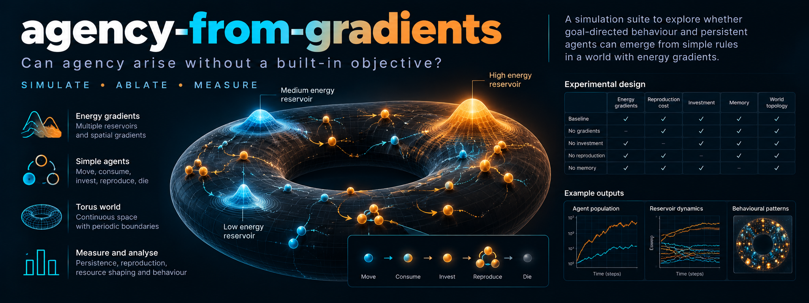

# agency-from-gradients

*The banner is an illustration. Its example charts are mock-ups, not results.*

Can agency arise without anyone handing the agent an objective?

That is the question. This repo is my attempt to answer it with code, not with an argument.

The usual way to build an agent is simple. You write down a goal. You reward the agent for reaching it. Done.

I wanted to try the opposite. Reproduce the conditions under which agency showed up on Earth. Then see what happens.

!!! warning "Read this first"
    This repo makes **no novelty claim** and proves **nothing about Earth**.

    These are toy worlds. A positive result only says a pattern survives ablation in an abstract setting. Whether the abstraction captures what mattered in reality is the central assumption. I state it openly, and I come back to it on every page.

## The headline

Here is the honest summary.

The thesis, as I preregistered it, is **only partly supported**. Its central ablation prediction, H2, **failed**.

Remove scarcity, heredity or mortality, and big-deposit access went *up*. Not down. The opposite of what I predicted.

Most of the later experiments, built to find out why, came back negative too. I report them all. A negative result you can trust is worth more than a positive one you can't.

## What each experiment found

| | Question | Verdict |
|---|---|---|
| [S1](results/main.md) | Does selection by persistence alone raise entropy production? | **Supported**, small effect |
| [S2](results/main.md) | Are scarcity, heredity and mortality each needed? | **Falsified** for all three |
| [S3](results/main.md) | Does the accounting hold up? | **Passes**, barely |
| [S4](results/main.md) | Does heredity help recovery from displacement? | **Supported**, with a caveat |
| [S6](results/s6.md) | Is the S2 failure a free-rider problem? | **Not supported** at this power |
| [S7](results/s7.md) | Do bigger genomes and more generations help? | **Not supported**. 90% of big-genome runs went extinct |
| [S8](results/s8.md) | What does an explicit entropy objective produce? | **A furnace**, not agency |
| [S9](results/s9.md) | Does a learned private reward produce agency? | **Not supported** |
| [S10](results/s10.md) | Does England-style dissipative adaptation climb the ladder? | **Not supported** |
| [S11](results/s11.md) | What best raises the entropy of a lifeless universe? | **A black-hole engineer**, as the literature suggests |

## How the site is organised

- **[The idea](idea.md)** explains the argument and where it comes from.
- **[Hypotheses and falsifiers](hypotheses.md)** lists what I wrote down before looking, and what would change my mind.
- **[The thesis, rebuilt from the hypothesis](thesis.md)** states the claim first, derives the predictions, reads the evidence against them, and ends with the revised thesis.
- **[Why the next experiment starts before life](before-life.md)** records the decision to move the start line back, before the replicator, and the case against it.
- **[The world](world.md)** describes the simulation in plain language.
- **[Results](results/index.md)** has every experiment, its numbers, and what it does *not* show.
- **[How to run](running.md)** gets you from `pip install` to your own results.
- **[Known limitations](limitations.md)** is the page I would read first if I were you.

## A note on how to read the numbers

Every interval on this site is a 95% bootstrap confidence interval. A hypothesis counts as *supported* only if the interval excludes zero in the stated direction.

An interval that includes zero means one thing: *not shown at this power*. It does **not** mean "no effect".

That distinction matters more than it sounds. Keep it in mind as you read.
