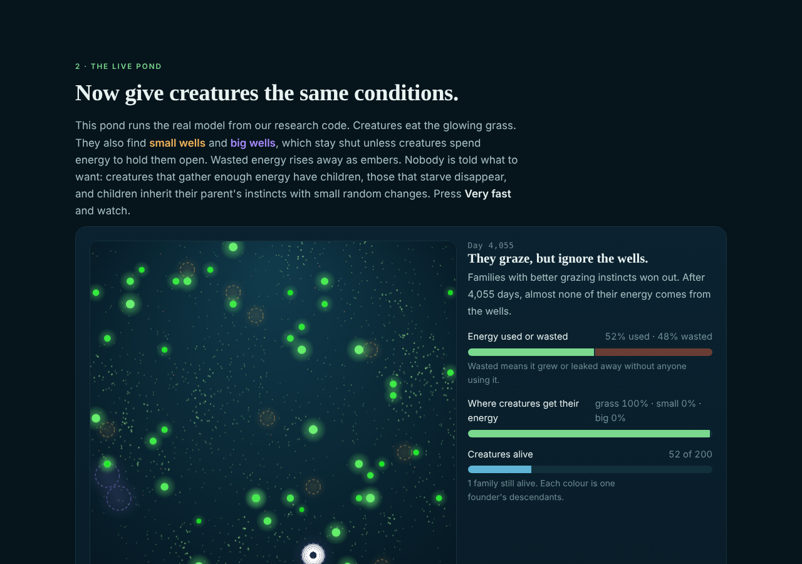
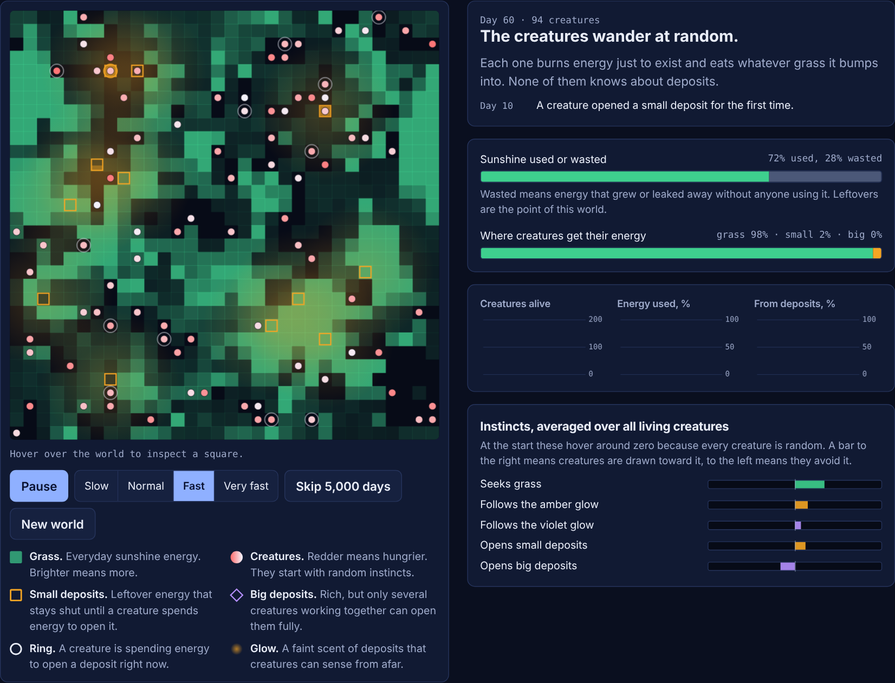
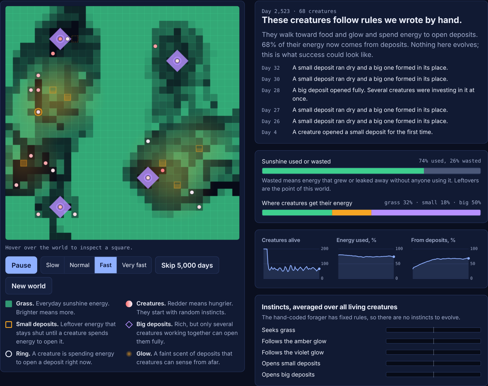
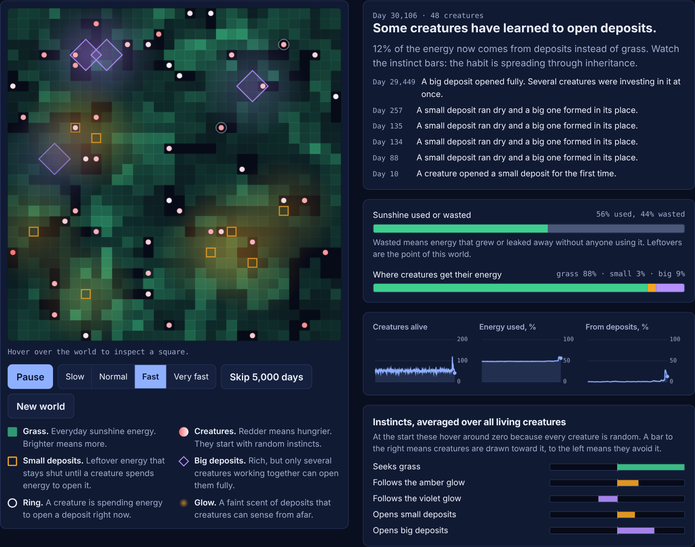
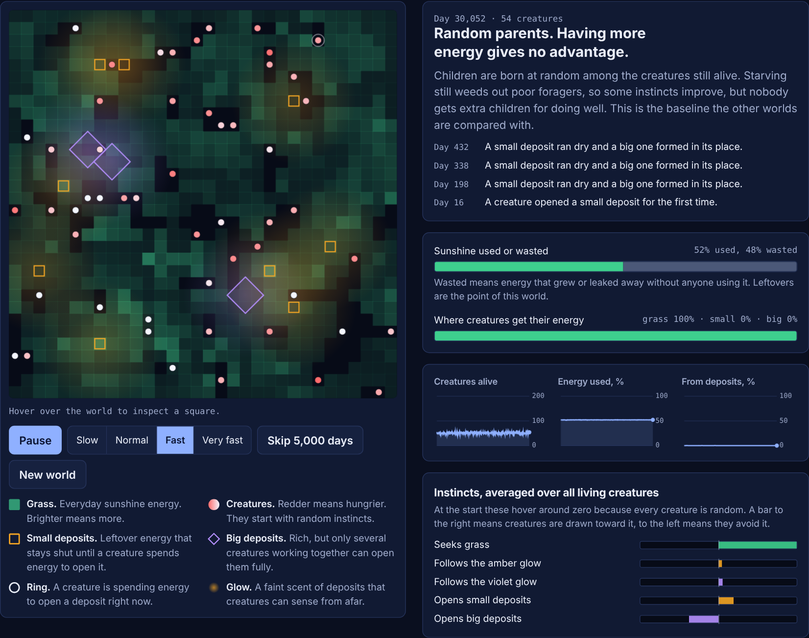
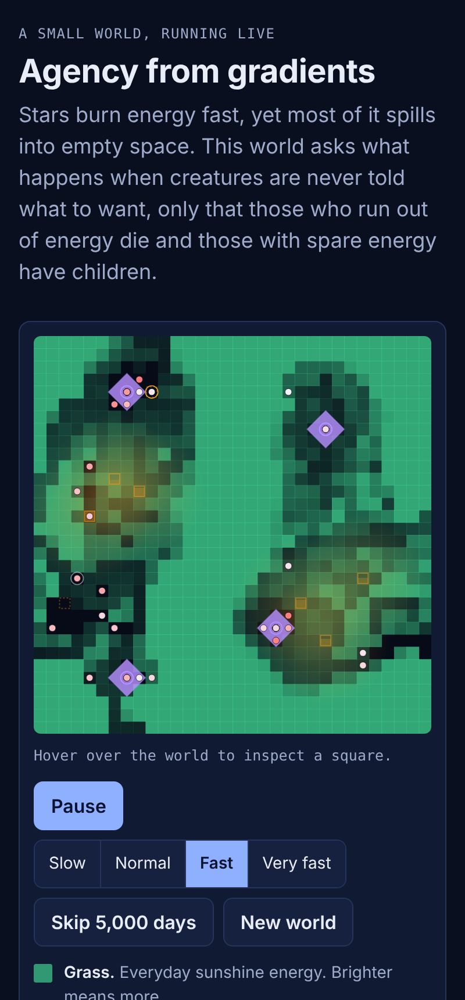

# Try it live

You do not have to install anything. Four things run in your browser.

!!! note "Links assume the standard project-page URL"
    They point at `praveenchandrahas.github.io/agency-from-gradients/`. If the repo is published somewhere else, update them.

## The plain-language explainer

**[Open the explainer](https://praveenchandrahas.github.io/agency-from-gradients/)**

A scroll-through page for non-specialists. It has:

- A waterfall picture of "energy always spills".
- A live pond. The same model, drawn as swimming creatures, glowing energy motes and wells.
- The real 30-seed results, in plain words.
- A switchboard that replays the actual ablation data. Nothing in it is simulated live.
- A list of what the work does *not* show.

## The grid view

**[Open the grid view](https://praveenchandrahas.github.io/agency-from-gradients/lab/)**

The technical view. A single self-contained file. It runs the same world in JavaScript, in real time.

It narrates what you are seeing. A headline for the current state. A "sunshine used or wasted" bar. Where the creatures' energy comes from. And a panel of their average instincts.

It has four presets.

| Preset | What it does |
|---|---|
| **Natural selection** | Random creatures. Those with spare energy have children |
| **Random parents** | The control |
| **Reward burning energy** | Entropy used as the reward |
| **A hand-coded expert** | Fixed rules I wrote, to show what success could look like |

### Reading the screenshots

Single seeded runs, chosen to show the interface. **They are not evidence.** The evidence is the preregistered experiments.

**Day 60.** Every creature starts with random instincts. 98% of their energy is grass. Large amounts of energy are wasted.

**The hand-coded expert, day about 2,500.** Rules I wrote by hand. 50% of the energy comes from big deposits. This is the positive control: it shows the world has headroom. Nothing evolves here.

**Natural selection, day about 30,000.** Here, inheritance has shifted the instincts. 9% of energy comes from big deposits. But this is one run. In others, evolved creatures never use the deposits. That is exactly why the confirmatory experiments use 30 seeds, not a picture.

**Random parents, day about 30,000.** All energy is grass. Remember this control is [not fully neutral](limitations.md#6-the-drift-control-is-not-fully-neutral).

{ width="320" }

## The film and the long-form site

**[Open the long-form site](https://praveenchandrahas.github.io/agency-from-gradients/learn/)**

The idea, the five conditions, the design rule, every experiment from S0 to S10 with its predictions and numbers, an interactive England bias dial, and a FAQ. Every number is copied from the reports.

**[Watch the film](https://praveenchandrahas.github.io/agency-from-gradients/learn/film.html)**

3 minutes 42 seconds. Ten chapters. No sound. Captions drawn on screen. The small world in chapter 5 is an illustration with hand-written rules, not a recorded run.
