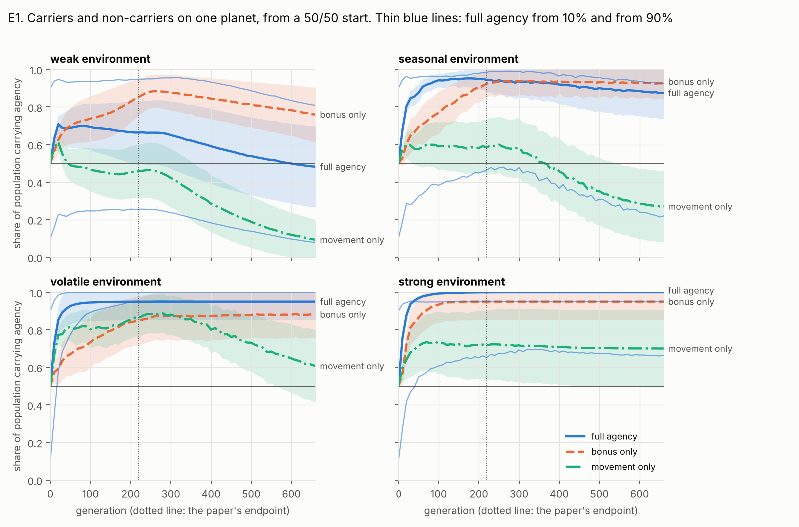
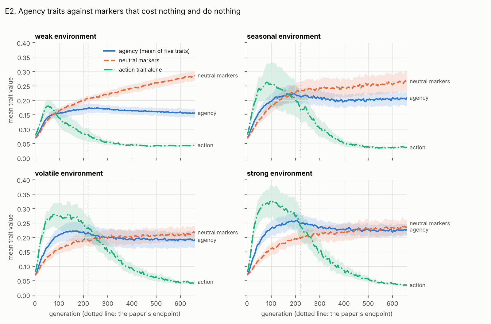
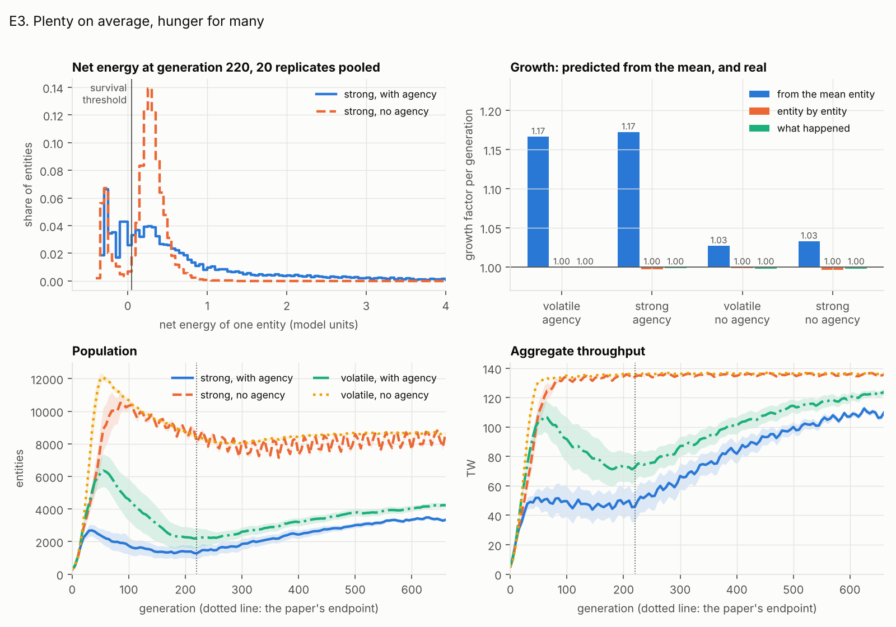
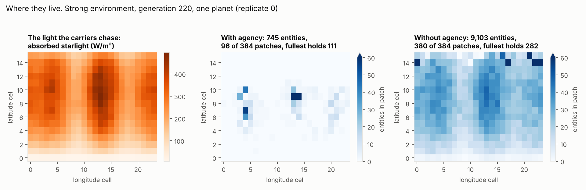

# Planet

Three follow-up experiments on the spatial model from the paper
"Energy Capture, Agency, and Planetary Entropy".

The paper's model is v0.2. Its code lives in
[`dissipative-agency-simulation`](https://github.com/praveenchandrahas/dissipative-agency-simulation).
It is copied here unchanged (commit `7126bb2`), as `planet/v0_2.py`.

## Why

A consistency check of the paper left three gaps.

1. Agency carriers and non-carriers never met. They lived on separate planets. So "individual advantage" was never shown between individuals.
2. Agency traits rose from 0.07 to about 0.2. Nobody had measured how far a trait rises if it does nothing.
3. Each entity had plenty of energy, yet populations stayed small. The stated rules said they should grow.

One experiment for each. Predictions were written and pushed before any run.

## The model in six lines

- A planet of 384 patches. Starlight falls on it, uneven and shifting.
- Entities sit on patches and harvest a share of the light. They pay running costs.
- Well-fed entities survive and have children. Children copy their parent, with small mutations.
- Eight heritable traits. One is collector size. Five are "agency": sensing, processing, prediction, planning, action.
- Agency lets an entity walk to the brightest neighbouring patch. Equation 4 of the paper also pays it a direct harvesting bonus.
- Nothing rewards entropy. It is only measured.

## The three additions

- **E1, competition.** Each entity carries a heritable flag: carrier or not. Both kinds share one planet.
- **E2, neutral markers.** Five extra numbers per entity. They start, mutate and clip exactly like the agency traits. They cost nothing and do nothing.
- **E3, demography.** Births, deaths, crowding and the spread of net energy, every generation.

With all three switched off, the engine gives the paper's numbers bit for bit. The tests check that.
Runs go to 660 generations. The first 220 are the paper's.

## What it found

Full tables are in [`RESULTS.md`](RESULTS.md). 9 of 12 predictions held. The three that failed were Claude's own guesses.

**1. Carriers win. And the planet loses.**
From a 50/50 start, carriers reach 95% in the volatile environment and 100% in the strong one.
(Volatile: carriers took over 19 planets of 20 and died out on one.)
The paper's premise holds. The check had called it unshown. It is shown now.
As carriers take over, the planet's throughput falls to 44 TW in the strong environment. Non-carriers alone reach 135.
So the paper's counterexample now happens inside one world: the type that wins is the type that lowers the total.

Both routes work. The Equation 4 bonus alone takes carriers to 84 to 95%.
Movement alone wins in the volatile (86%) and strong (72%) environments. It does not in the weak one (46%).
The weak environment is the exception throughout: 66% at the paper's endpoint, 48% by generation 660.



**2. Most of the rise in agency is what a do-nothing trait does.**
The markers rose from 0.07 to about 0.2 with no help from selection.
Mutation pushes a trait off the zero floor, and the floor does not push back.
Agency beat its markers only in the strong environment, by 0.057 [0.020, 0.093].
In the weak environment it ended below them.
By generation 660 it was at or below them everywhere.

So "agency evolved" needs care. Carrying a little agency beats carrying none (finding 1).
Carrying more is not favoured beyond what drift gives. Why that is so was not tested.



**3. Plenty on average, hunger for many.**
The mean entity in an agency world earns enough to grow 17% a generation. Real growth is zero.
The mean hides the spread. 31% of entities sit below the survival threshold. Without agency it is 10%.
A lucky tenth earns more than eight times the median.

Two thirds of the population lives in the fullest 5% of patches. Without agency it is one sixth.
The paper called this concentration. That word is right.




**4. Generation 220 is the bottom of a dip.**
The action trait rises early, while the planet is empty and walking to bright patches pays.
Then it is purged. By generation 660 it is 0.04 in every environment, far below its marker.
As it goes, populations spread out again and throughput recovers: 48 to 108 TW in the strong environment, 72 to 123 in the volatile one.
The gap to the no-agency world is still there at 660. It is a third of what it was.

**5. Sensing barely steers.**
Carriers with almost no sensing still pick the truly best neighbour 95 to 99% of the time.
The sensing noise is small against the differences between patches. So sensing, processing and prediction earn their keep through Equation 4, not through better choices.

## What this changes

For the paper:

- The individual-versus-aggregate result is stronger than the paper claimed. It can now cite a shared-planet test.
- "Evolved non-zero agency-like traits" overstates. Most of that rise is neutral.
- The aggregate loss belongs to a phase, and to the action trait. A longer run should be reported beside generation 220.
- The ceiling caveat stands. Non-carriers already capture 98 to 99% of the pool. Agency could tie or lose, never win.

For the check that prompted this:

- Its gap 1 was a real gap, and it closes in the paper's favour.
- Its "roughly break-even" arithmetic for the weak environment used a light spread of 0.05 to 0.1. The measured spread is 0.27. The conclusion survived anyway, and more strongly than claimed.
- Its "sparser, not crowded" line holds on one measure in one pair at one endpoint. On the share measure the paper is right. That line overreached.

## Run it

```bash
pip install numpy pandas matplotlib pytest
pytest -q                                  # 24 tests, about 10 seconds

python experiments/run_pure.py --smoke     # plumbing check, seconds
python experiments/run_pure.py             # E2 and E3. About 4 minutes on 2 cores
python experiments/run_mixed.py            # E1. About 13 minutes
python analysis/report.py                  # writes RESULTS.md and figures/
```

## Layout

```
planet/v0_2.py            the paper's source, unchanged
planet/engine.py          the same rules, with the three additions
tests/test_engine.py      bit-for-bit equality with v0_2, bookkeeping, switches
experiments/              run_pure (E2, E3), run_mixed (E1), and a shared runner
analysis/report.py        every number in RESULTS.md comes from here
PREREGISTRATION.md        predictions and falsifiers, frozen before the runs
RESULTS.md                the outcome, prediction by prediction
results/                  CSVs and RUN_INFO.txt (hashes of the frozen files)
figures/
```

## What it does not show

- **Nothing about Earth.** It is a toy, and its numbers in TW and GW are scaling devices.
- **Nothing about where agency comes from.** The five traits and their payoffs are written in by hand.
- **Why carriers win is not settled.** They win while their mean survival is lower than the non-carriers'. A likely reason: births go to the highest earners, and carriers own the top of the range. That is a guess. It was not tested.
- **The carrier flag cannot mutate.** A real population could lose agency one trait at a time. E2 shows what happens then.
- **Markers ride with the rest of the genome.** There is no recombination. They are the right null for this model, and only for this model.
- **One model, 20 replicates per cell.**
